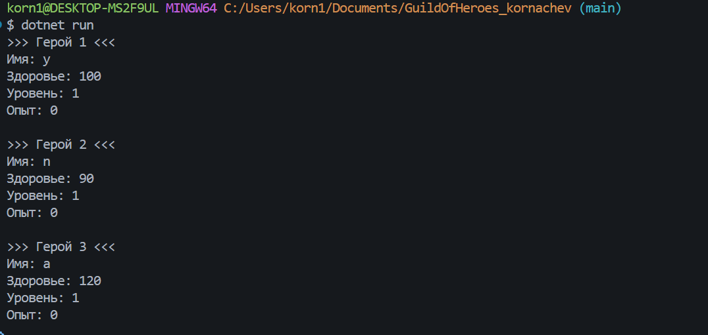

# GuildOfHeroes

Автор: Корначев Кирилл Александрович
Дата выполнения: 27.10.2026
## Задание 1. Ответы на вопросы
> Какой объект является одним из основных объектов моей программы?
```text
Hero
```
## Задание 2. Определите состояние объекта
```text
Name
Health
Level
Experience
```
## Задание 3. Создайте класс
```text
Game.cs
```
```csharp
public class Hero {
    public string ZapyskIgri;
    public int Health;
    public int Ogon;
    public int Time;

    public Hero(string name, int health) {
        ZapyskIgri = name;
        Health = health;
        Ogon = 1;
        Time = 0;
    }
}
```
## Задание 4. Создайте Объекты
```csharp
public class Game {
    public string Z;
    public int H;
    public int O;
    public int T;

    public Game(string name, int zap) {
        Z = name;
        H = zap;
        O = 1;
        T = 0;
    }
}
```
## Задание 5. Выведите состояние объектов

## Задание 6. Ответы на вопросы

## Собственный проект

Тема проекта: ZHOT

Главный класс: Game

Почему этот объект нужен программе:
Чтобы он мог выводить другие типо значения заданные мною. И без такого класса пришлось бы хранить данные игры в отдельных переменных.

Какие данные хранит объект:

- Z
- H
- O
- T

Какие значения задаются через конструктор:
Z, H

Какие значения можно задавать автоматически:
O, T 

